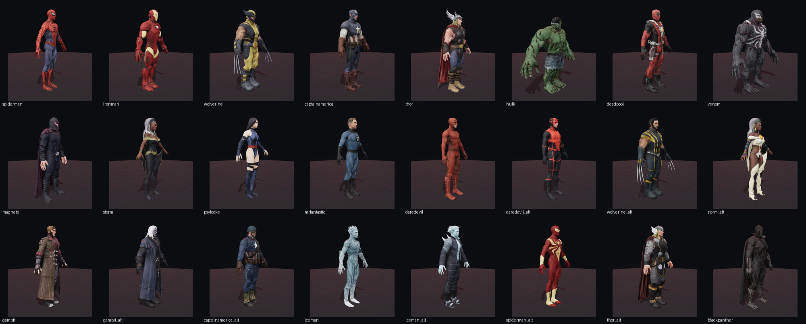

# MUA2 // Alchemy Asset Viewer

Visualizador **three.js** para modelos, texturas e efeitos extraídos de
**Marvel: Ultimate Alliance 2 (PC, 2016 – Alchemy 6 / IGZ v6)**.



## Rodar

```bash
cd mua2-viewer
./start.sh          # ou: python3 -m http.server 8088
# abra http://localhost:8088
```

Controles:

| Ação | Como |
|---|---|
| Orbitar | arrastar com o botão esquerdo |
| Zoom | scroll |
| Pan | botão direito / dois dedos |
| Trocar personagem | clique na lista ou teclas `1`–`9` |
| Wireframe | `W` |
| Texturas on/off | `T` |
| Reset da câmera | `R` |
| Toggle do Rig (ossos) | `B` ou botão `🦴 Rig` |
| Auto-rotação | `Espaço` |
| Galeria VFX | botão `✦ VFX` |

## O que está incluído

- **184 personagens, variantes, NPCs e props** em glTF 2.0 (`.glb`) com diffuse + normal map:
  Spider-Man, Iron Man, Wolverine, Capitão América, Hulk, Deadpool,
  Thor, Venom, Magneto, Storm, Psylocke, Sr. Fantástico, Demolidor,
  Gambit, Homem de Gelo, Pantera Negra, Cable, Yellowjacket, Jean Grey,
  Tocha Humana, Ms. Marvel, Nick Fury, Luke Cage, Duende Verde,
  Mulher Invisível, She-Hulk, Colossus, Goliath, Hércules, O Coisa
  e outros. Use a busca da barra lateral para filtrar.
- **Galeria VFX** com 54 efeitos e as texturas originais extraídas de
  `effects_igx.bin` (`assets/vfx/effects_curated.json`).
- **Esqueleto & Rig integrados**: cada modelo agora carrega sua
  hierarquia completa de ossos (`skins` glTF 2.0, `JOINTS_0` + `WEIGHTS_0`)
  extraída do `igSkeleton2` e `igSkeletonBoneList` da Alchemy 6.
  Use o botão **🦴 Rig** ou a tecla <kbd>B</kbd> para ligar a visualização
  dos ossos (SkeletonHelper do three.js).
- As animações do jogo estão em `_work/igz_anims/` (447 arquivos Havok 6.1
  `.hkx` catalogados em `tools/hkx_catalog.py`); as poses dos modelos
  podem ser manipuladas diretamente via `skinnedMesh.skeleton.bones`.
- Texturas DXT1/DXT5/ATI2 decodificadas para PNG.
- **Correção do `data_off`**: o tamanho da cadeia de mips tem que usar a
  contagem real de mips do `igImage2` (`+0x1A`). Calcular a cadeia até
  1×1 em vez disso adianta `data_off` em 23 blocos DXT (92 texels) e
  **desloca toda textura de lado** — as ilhas UV da malha deixavam de
  bater com a arte (manchas cinzas, textura "errada" em todo personagem).
- DXT1 difuso decodificado como opaco (modo 4 cores, fiel ao jogo:
  ~30% dos blocos têm `c0<=c1`, que no DXT1 padrão seria alpha).
  `alphaMode: MASK` só quando há alpha real.
- Normal maps DirectX (Y-) convertidos para OpenGL (Y+) no bake.
- Fundo cinza dos atlas preenchido por *inpainting* (detecção por
  distância à cor `[90,89,90]` com guarda de saturação, incluindo vãos
  internos entre ilhas UV).

## Pipeline (resumo)

```
ISO (UDF)
  └─ setup-1.bin (FreeArc: 4x4 + LZ4 + REP)
      └─ arquivos do jogo: models.bin, materials.bin, textures.bin, actors.bin...
          └─ .bin (Zoe Mode: XOR + zlib)  →  .igz (Alchemy 6)
              └─ IGZ v6 (fixups, RVTB, nós, geometria, materiais)
                  └─ glTF 2.0 (.glb)  →  three.js
```

Ferramentas em `tools/`:

- `mua2bin.cpp` — extrai os arquivos `.bin` (XOR + zlib).
- `mua2_glb.py` — lê IGZ v6, extrai geometria e materiais e gera GLB.
- `index_textures.py` — indexa hash → textura (DXT/ATI2).
- `index_effects.py` — indexa os `effects_igx` e gera thumbnails.
- `export_all.py` — exporta o lote de personagens.
- `extract.cpp` — decodifica o bloco FreeArc do instalador (4x4+LZ4+REP).

Dependências Python: `numpy`, `scipy`, `Pillow`.
O parser IGZ usa o projeto **[igb-blender](https://github.com/KaikoClanworth1/igb-blender)**
(GPL-3.0) como dependência externa — veja `tools/README.md`.

## Limitações conhecidas

- **Bind pose**: os modelos são estáticos. O skeleton e as animações
  existem nos arquivos, mas ainda não foram exportados.
- **VFX**: a galeria mostra as texturas e a definição dos efeitos; o grafo
  de partículas original do jogo não é reproduzido.
- Alguns atlas têm regiões cinzas que aparecem como manchas em certos
  modelos (ex.: antebraço do Spider-Man); o inpainting reduz, mas não
  elimina 100%.
- Texturas DXT1 são decodificadas no modo 4 cores (o jogo usa esse modo,
  não o 3 cores + alpha padrão).

## Aviso

Os assets são © Marvel / Activision / Vicarious Visions. Use apenas com
uma cópia legítima do jogo, para uso pessoal/estudo. Não redistribua os
arquivos extraídos.
